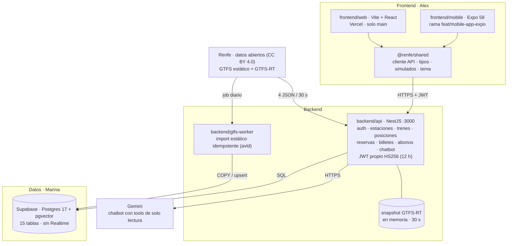
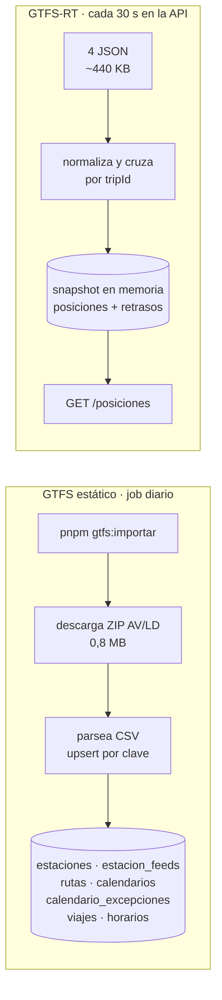

# 🧭 Arquitectura

> Documento de referencia. Si el código y este documento discrepan, se avisa antes de cambiar nada:
> el contrato (`obsidian/02-contratos-api/`) y estas reglas mandan hasta que un ADR diga lo contrario.

## 1. Vista general

Lo que hay **hoy en `develop`**, no lo que estaba previsto en octubre:



Piezas y responsabilidad:

| Pieza | Responsable | Qué hace | Qué NO hace |
| --- | --- | --- | --- |
| `frontend/web` (Vite + React) | Alex | Demo completa: buscar, reservar, billetes, revisor, mapa, cuenta | No habla con Renfe ni con Postgres |
| `frontend/mobile` (Expo) | Alex | App iOS/Android; calcula el vector facial en el dispositivo | Ídem. **Vive en rama sin mergear** |
| `frontend/shared` (`@renfe/shared`) | Alex | Cliente de la API, tipos del contrato, simulados, contenido y tokens | Nada de UI |
| `backend/api` (NestJS) | Rubén | Una sola superficie REST; también sondea GTFS-RT | No descarga GTFS estático |
| `backend/gtfs-worker` (Node) | Marina | Única entrada del GTFS estático | No atiende peticiones ni toca GTFS-RT |
| Supabase (Postgres/pgvector) | Marina | Datos, `auth.users`, embeddings y **decisión** del login facial | No se expone a la app |
| Gemini API | Rubén | Chatbot con *function calling* | No tiene acceso directo a la BD |

**Ya no existe:** `backend/face-service` (Python), Stripe (pagos simulados), Supabase Realtime
(sustituido por `GET /posiciones`) y las tablas `gtfs_*` / `rt_*` (se llaman `estaciones`, `viajes`…).

## 2. Fuentes de datos reales

Verificado el 2026-10-26. Todo es **datos abiertos de Renfe, CC BY 4.0** (atribución obligatoria en la app).

| Dato | Fuente | Volumen medido |
|---|---|---|
| Estaciones, rutas y horarios de **Cercanías** | `https://ssl.renfe.com/ftransit/Fichero_CER_FOMENTO/fomento_transit.zip` | 15,1 MB · 1.147 paradas · 271 rutas · 132.334 viajes · 1.826.757 horarios · 450 calendarios · 19 transbordos · 123.734 puntos de trazado |
| Estaciones, rutas y horarios de **AVE / Larga y Media Distancia** | `https://ssl.renfe.com/gtransit/Fichero_AV_LD/google_transit.zip` | 0,8 MB · 1.008 paradas · 663 rutas · 8.681 viajes · 68.829 horarios · 8.681 calendarios · 32.137 excepciones · **sin trazados ni transbordos** |
| Posiciones en vivo de Cercanías | `https://gtfsrt.renfe.com/vehicle_positions.json` (también `.pb`) | ~133 KB · **348 trenes** |
| Retrasos de Cercanías | `https://gtfsrt.renfe.com/trip_updates.json` | ~142 KB · 349 viajes |
| Posiciones en vivo de AVE/LD/MD | `https://gtfsrt.renfe.com/vehicle_positions_LD.json` | ~65 KB · **192 trenes** |
| Retrasos de AVE/LD/MD | `https://gtfsrt.renfe.com/trip_updates_LD.json` | ~50 KB · 207 viajes |
| Incidencias y avisos | `https://gtfsrt.renfe.com/alerts.json` | ~99 KB · 69 avisos |
| Catálogo de datasets (metadatos) | `https://data.renfe.com/api/3/action/package_search` (CKAN) | 44 datasets |

Comportamiento observado de los endpoints GTFS-RT:

- **Sin CORS** (`Access-Control-Allow-Origin` ausente) → no se pueden llamar desde el navegador;
  por eso los lee la API (o la función de Vercel, como plan B).
- **Sin compresión** → cada petición viaja en crudo.
- `Cache-Control: max-age=30, public` → ellos esperan un sondeo cada 30 s.
- No publican límite de peticiones: hay que reintentar con *backoff* y no perder la última copia válida.

**No existe** API pública de búsqueda con precios, disponibilidad, reserva ni pago. Los endpoints internos
de `renfe.com` y su app no están documentados y su uso va contra sus condiciones: **no se usan**.

## 3. Qué es real y qué es simulado

| Real (datos abiertos Renfe) | Simulado |
|---|---|
| Estaciones, rutas, horarios (GTFS) | Precios |
| Posiciones y retrasos (GTFS-RT) | Asientos y ocupación |
| | Reservas, billetes y abonos (nacen pagados) |
| | Pagos: **no hay Stripe**, no hay pasarela |

## 4. Ingesta

Dos caminos distintos, y solo uno escribe en la base de datos:



Reglas del worker:

- **Idempotente**: reimportar el mismo día no duplica nada (upsert por clave natural + `feed`).
- **Degradable**: si Renfe falla, se conserva la última importación válida y se registra el error.
- **Nunca** escribe en las tablas de negocio (`reservas`, `billetes`, `abonos`, `asientos`).
- Hoy solo importa el feed **`avld`**. Cercanías tiene el código preparado, pero no está cargado.

## 5. Camino de una petición

### 5.1 Buscar trenes (sin salir a internet)

```
 App                    API NestJS                        Postgres
  │  GET /trenes?origen=60000&destino=71801&fecha=2026-11-02
  ├──────────────────────▶│
  │                       │ 1. DTO: fecha válida, origen ≠ destino
  │                       │ 2. SQL: servicios activos ese día
  │                       │      ⨝ viajes ⨝ horarios(origen) ⨝ horarios(destino)
  │                       │      WHERE secuencia_origen < secuencia_destino
  │                       ├──────────────────────────────────▶│
  │                       │◀──────────────────────────────────│ 15-40 ms
  │                       │ 3. DTO: viaje, línea, sale, llega, precio simulado
  │◀──────────────────────│
  │ 200 · objetivo < 150 ms
```

Es pública (sin token). Si la BD no está, `503`: aquí no hay datos de reserva.

### 5.2 Reservar, QR y validar (sin Stripe)

```
1  POST /reservas         → API elige butacas libres (for update skip locked)
                            y escribe reserva + asientos + billetes en UNA transacción
                            → estado "pagada" (el pago es simulado)
2  GET /billetes          → la app pinta el QR `RNF1.<datos>.<firma>`
3  POST /billetes/validar → revisor escanea → API verifica firma + estado en BD
                            → primera vez: billetes.estado = "usado"
4  POST /abonos           → abono nace "activo" con su QR `RNA1.…`
```

Firma **HMAC-SHA256** con `QR_SIGNING_SECRET` mientras no existan las claves Ed25519
(`QR_SIGNING_PRIVATE_KEY` / `PUBLIC_KEY`). Cambiar de algoritmo solo toca `common/qr/firma.ts`.
La tabla `validaciones` es *append-only* y guarda también los intentos fallidos.

### 5.3 Tiempo real

```
Renfe GTFS-RT ──4 JSON / 30 s──▶ API (snapshot en memoria)
                                     │
                                     ├─ cruza con viajes/horarios/estacion_feeds
                                     │  (una consulta por feed y refresco)
                                     ▼
                            GET /posiciones ──HTTPS──▶ mapa de la app
```

- **No hay worker de GTFS-RT ni Supabase Realtime**: la app pregunta, no recibe.
- Si falla el feed de retrasos pero no el de posiciones, se sirve el mapa con `retrasoSeg: null`.
- Si Renfe falla, se sigue sirviendo el último snapshot bueno y `actualizado` deja de avanzar.
- Plan B en la web: `frontend/web/api/posiciones.ts` (función de Vercel con la misma lógica).

### 5.4 Login facial y chatbot

```
Login facial   dispositivo: Human (detección, antispoof, malla) + ArcFace → vector
               POST /auth/cara/verificar → API → verificar_cara() en Postgres
               → similitud coseno ≥ umbral de config_cara → JWT propio de la API
               (la foto no sale del dispositivo y no se guarda nunca; ver ADR-007)

Chatbot        POST /chatbot/mensaje → API → Gemini (function calling)
               → Gemini consulta herramientas internas de solo lectura
               → respuesta en lenguaje natural
```

La app móvil calcula el vector con `expo-camera` y lo envía; no hay servicio facial propio.
**Pendiente:** el contrato y la BD piden **512** floats (ArcFace) y la web hoy produce 1024 (Human).

## 6. Reglas de arquitectura (no negociables)

1. **Una sola entrada del GTFS estático: el worker.** Ni la app ni la API lo descargan.
2. **La app solo conoce** `VITE_API_URL` / `EXPO_PUBLIC_API_URL` y la API. Nada de Postgres,
   secretos ni Renfe.
3. **El contrato manda.** Endpoint, tabla o evento nuevo → se escribe en `obsidian/02-contratos-api/`
   *antes* del código.
4. **Postgres es la única memoria de negocio.** La única excepción es el snapshot GTFS-RT de la API,
   que es caché, no estado.
5. **El login facial no crea sesiones por sí solo:** el vector se compara en Postgres y el token lo
   firma la API (HS256, 12 h, sin `refresh_token`).
6. **Nada de secretos en el vault ni en el repo.** Solo `.env.example`.
7. **Precios, asientos y pagos son simulados.** Cualquier pantalla que los enseñe debe decirlo.

## 7. Trampas conocidas de los datos

| # | Trampa | Qué hacer |
|---|---|---|
| 1 | Cercanías y AVE/LD son **dos feeds separados**: posiciones y retrasos en ficheros distintos | Guardar columna `feed` en todas las tablas y sondear los 4 JSON |
| 2 | Los `tripId` de AVE/LD llevan la fecha pegada (`3560412026-10-24`) | **No quitar nada**: el `trip_id` de `trips.txt` la lleva igual (comprobado el 27/10 con el fichero real). Cada `trip_id` es un viaje de un día |
| 3 | 1,8 M filas de horarios (Cercanías) | `COPY`, nunca `INSERT` fila a fila |
| 4 | Horas GTFS pueden pasar de 24:00 (tren de las 25:10) | Guardar segundos enteros, no tipo `time` |
| 5 | Cercanías no trae `pickup_type` / `drop_off_type` | No se puede filtrar paradas técnicas por campo; en AVE sí vienen |
| 6 | La misma estación física tiene `stop_id` distinto en cada feed (Atocha) | Decidido: una estación lógica, tabla `estacion_feeds` |
| 7 | AVE/LD no trae `shapes` | Trazado de línea solo para Cercanías; AVE se dibuja con puntos |
| 8 | Renfe regenera el estático a diario | Import diario idempotente, nunca `INSERT` a pelo |

## 8. Rendimiento y límites

| Aspecto | Medida |
|---|---|
| Import `avld` | ~1 min (1 035 estaciones · 8 908 viajes · 71 781 horarios) |
| Búsqueda de trenes | objetivo < 150 ms (índice `(stop_id, departure_seconds)`) |
| Vuelta de GTFS-RT | 4 peticiones ≈ 440 KB cada 30 s, compartidas entre todas las peticiones |
| Trenes en vivo | ~500 posiciones (210 AVE/LD + 298 Cercanías) |
| Coste de ir directo a Renfe desde la app | ~24 MB/hora por usuario, sin compresión y sin CORS |
| Caché | No hace falta Redis: Postgres indexado + snapshot en memoria |

## 9. Decisiones cerradas y abiertas

| Decisión | Estado |
|---|---|
| Estaciones entre feeds | **Cerrada**: una estación lógica + `estacion_feeds` |
| Tiempo real | **Cerrada (27/10)**: snapshot en memoria en la API + `GET /posiciones`. Sin worker ni Realtime |
| Login facial | **Cerrada (ADR-007)**: vector en el dispositivo, decisión en Postgres, sin servicio Python |
| App móvil | **Cerrada (ADR-005)**: Expo SDK 58 + `@renfe/shared`; la web queda como demo |
| Despliegue final | **Propuesta (ADR-009)**: Docker Compose en el servidor. Hoy Render + Supabase Cloud |
| Transbordos | **Fuera** de fase 1 |
| Atribución CC BY | Obligatoria en Ajustes / Acerca de |

Lo que se decida de aquí en adelante va a `obsidian/03-decisiones/` como ADR nuevo.

## 10. Estado por pieza

| Pieza | Quién | Estado real |
|---|---|---|
| API: estaciones, trenes, detalle, posiciones, health | Rubén | ✅ implementado y probado contra Postgres/Supabase |
| API: auth (contraseña + cara) y JWT propio | Rubén | ✅ implementado |
| API: reservas, billetes, QR, validación, abonos | Rubén | ✅ implementado (pago simulado) |
| API: chatbot | Rubén | ✅ implementado (Gemini) |
| API: `/incidencias`, `/admin/resumen`, `/pagos/*` | Rubén / Kevin | ⛔ no implementados |
| GTFS estático (`avld`) | Marina | ✅ importado y verificado en Supabase Cloud |
| GTFS-RT (posiciones y retrasos) | Rubén | ✅ en memoria de la API |
| Web | Alex | ✅ desplegada en Vercel (solo `main`) |
| App móvil | Alex | 🟡 existe en la rama `feat/mobile-app-expo`, **sin mergear** |
| Docker del servidor (ADR-009) | Rubén / Kevin | 🟡 escrito y validado con `docker compose config`, nunca construido |

## 11. Fuera de alcance

- Precios, aforo y disponibilidad reales (no existen).
- API privada de `renfe.com` (no documentada, anti-bot, contra sus condiciones).
- Stripe y cualquier pasarela de pago real.
- Transbordos en fase 1.
- Historial de posiciones más allá del snapshot.
- App nativa con polls directos a Renfe.

## 12. Enlaces

- Plan original del proyecto (claude.ai): https://claude.ai/artifact/2w2FZuQJhMrEuGHxAWdKfw
- Decisiones: `obsidian/03-decisiones/` (ADR-001 a ADR-009)
- Contrato de endpoints: `obsidian/02-contratos-api/endpoints.md`
- Modelo de datos: `obsidian/02-contratos-api/modelo-datos.md`
- Eventos en tiempo real: `obsidian/02-contratos-api/eventos-realtime.md` (obsoleto: no hay Realtime)
- Flujo de trabajo Git: `docs/flujo-trabajo.md`
- Levantar todo en local: `docs/levantar-en-local.md`
