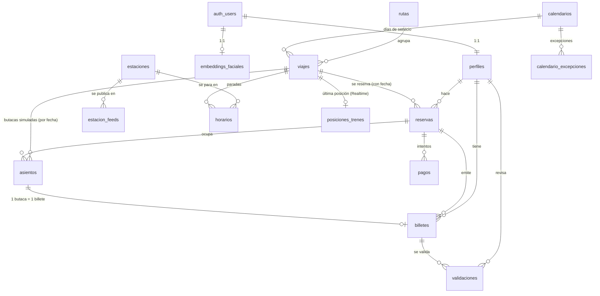

# 🗄️ Modelo de datos (Supabase)

> **Fuente de verdad del esquema.** Se diseña aquí y después se migra en
> `backend/database/supabase/migrations/`. Si el código y esta nota discrepan, manda la nota:
> se cambia primero aquí y luego se implementa (ver `AGENTS.md`).
>
> Alcance de esta versión: **contrato, sin SQL**. No hay migraciones todavía a propósito.
> Encaja con el contrato de [[endpoints]] de Rubén (dos feeds, `feed` en viajes/posiciones/incidencias
> y estaciones unificadas con `feeds[]`).
>
> **Revisado contra los ficheros reales de Renfe el 28/10/2026** (GTFS de Cercanías y de AV/LD/MD,
> CSV de estaciones y los cuatro endpoints de GTFS-RT). Los datos medidos mandan sobre las
> suposiciones del primer borrador: ver §4.6, §6.1, §6.2 y §10.1. El plan de carga derivado está en
> [[plan-ingesta-gtfs]].

## 1. Principios de diseño

| # | Decisión | Motivo |
|---|---|---|
| 1 | **Claves naturales `text` de GTFS**, con `feed` por delante; **`uuid`** en lo que genera la app | Renfe publica **dos feeds** (`cercanias` y `avld`) y el mismo `stop_id`/`trip_id` no significa lo mismo en cada uno: la clave es `(feed, id)`. Son ids estables entre importaciones → `upsert` idempotente sin tablas de mapeo. Los datos de usuario necesitan ids opacos. |
| 2 | **`estaciones` unificadas** + tabla puente `estacion_feeds` | La app busca por nombre y la misma Atocha tiene `stop_id` distinto en cada feed. Una sola estación con un id estable y `feeds[]` (lo que ya promete `GET /estaciones`). |
| 3 | **Nombres en español y en plural** (`estaciones`, `viajes`), FKs `<tabla_singular>_id` | Coherente con el resto del proyecto; el móvil y la API leen lo mismo. |
| 4 | **Estados como `text` + `CHECK`**, no `ENUM` de Postgres | Las Supabase migrations corren dentro de una transacción y `ALTER TYPE ... ADD VALUE` no puede ejecutarse ahí. Con `CHECK` añadir un estado es un `ALTER TABLE` normal. |
| 5 | **`timestamptz` en todo**; horas de GTFS en `interval` | Renfe publica horas locales de Madrid (Europe/Madrid) y GTFS permite `25:30` para trenes que terminan pasada la medianoche: `time` no lo admite, `interval` sí. La API las convierte a ISO 8601 con offset. |
| 6 | **Nada se borra en duro salvo catálogo** | Reservas, pagos, billetes y validaciones son historial: se cambian de estado. El catálogo GTFS sí se reemplaza en cada importación. |
| 7 | **La API escribe siempre con `service_role`**; la app solo lee lo suyo | RLS protege el acceso directo de la app (sobre todo Realtime), no sustituye a la API. Ver §7. |
| 8 | **Asientos generados bajo demanda** por viaje **y fecha**, no materializados por feed | Materializar butacas de los ~149 000 viajes × días son millones de filas para un dato simulado. Se generan al vuelo la primera vez que se consulta. |
| 9 | **El feed ya viene expandido por fecha**: `viajes` tiene horizonte (`fecha_inicio`/`fecha_fin`), no plantillas perpetuas | Comprobado el 28/10: Cercanías trae 450 servicios, **todos de un solo día**, y el `trip_id` de AV/LD/MD lleva la fecha dentro (`0019012026-10-28`). El horizonte es lo que permite purgar lo caducado y responder `GET /trenes?fecha=` sin escanear todo. |

## 2. Diagrama de entidades



> Nota: `viajes` es un **viaje de un día** (`fecha_inicio`/`fecha_fin` salen de su calendario, que en
> el feed real es de un solo día en Cercanías y de un rango en AV/LD/MD). Todo lo que apunta a un
> viaje concreto añade `feed` + `fecha_servicio` (reservas, asientos, posiciones) o hereda la
> caducidad del billete.

## 3. Identidad y acceso

### 3.1 `perfiles`

Extiende `auth.users` (que gestiona Supabase Auth y no se toca).

| columna | tipo | null | notas |
|---|---|---|---|
| `id` | `uuid` | no | PK, `references auth.users(id) on delete cascade` |
| `rol` | `text` | no | `viajero` \| `revisor` \| `admin`, default `viajero` |
| `nombre` | `text` | no | para saludar y para el revisor |
| `creado_en` | `timestamptz` | no | default `now()` |
| `actualizado_en` | `timestamptz` | no | default `now()` |

**Diseño:** el perfil lo crea la **API** en `POST /auth/registro`, no un trigger sobre `auth.users`.
Un trigger mágico esconde el flujo y complica los tests; así la API lo hace en la misma
transacción lógica que el alta.
**`rol` no lo puede cambiar el usuario:** solo lo toca la API con `service_role`.

**RLS:** `select`/`update` del propio perfil. **`rol` no lo puede cambiar el usuario**: a
`authenticated` solo se le concede `update (nombre)` a nivel de columna, así que `rol` es inmutable
para él sin necesidad de trigger. El resto de columnas las toca la API con `service_role`.

**Índices:** PK basta. Índice parcial `(rol) where rol <> 'viajero'` para el panel del revisor y el
del admin.

### 3.2 `embeddings_faciales`

| columna | tipo | null | notas |
|---|---|---|---|
| `usuario_id` | `uuid` | no | PK, FK a `auth.users` `on delete cascade` |
| `embedding` | `vector(512)` | no | InsightFace, normalizado (L2 = 1) |
| `modelo` | `text` | no | p. ej. `arcface/buffalo_l`; permite invalidar al cambiar de modelo |
| `creado_en` | `timestamptz` | no | default `now()` |

**Diseño:** 1:1 con el usuario (verificación 1:1: la app dice quién es y se compara). Si algún día
se quiere 1:N («¿quién es esta cara?») se cambia la PK a `(usuario_id, modelo)` y se añade
índice; hoy no hace falta. **Nunca se guarda la foto**, solo el vector.

La FK va a `auth.users` y **no a `perfiles`** a propósito: el facial es de Rubén y `perfiles` es de
Marina, así que la migración del facial
(`20261028120000_reconocimiento_facial.sql`) no toca ninguna tabla de ella y se puede aplicar en
cualquier orden. El rol `admin` del reset se lee de `app_metadata`, igual que en `SupabaseJwtGuard`.

**RLS:** **ninguna política** para `anon` ni `authenticated` → nadie lee el embedding desde la app.
Solo `service_role` (la API). La comparación la hace Postgres en `verificar_cara`, nunca el móvil.

**Índices:** PK. Índice HNSW (`vector_cosine_ops`) solo si en el futuro se hace búsqueda 1:N.

**Reglas, todas en funciones `security definer`** (ver [[ADR-005-reconocimiento-facial]]):

- `registrar_cara(usuario, embedding, modelo)`: valida modelo y dimensión, normaliza y hace el alta.
  Falla con `cara_ya_registrada` si ya existe: **la cara se registra una sola vez**.
- `verificar_cara(email, embedding)`: similitud coseno contra `config_cara.umbral`; devuelve
  `coincide`, `similitud` y `motivo` (`ok` \| `sin_plantilla` \| `modelo_distinto` \| `no_coincide`).
- `resetear_cara(admin, usuario)`: borra la plantilla; lee el rol de `app_metadata` dentro de Postgres
  y solo deja pasar a `admin`.
- `config_cara` (una fila): `modelo` y `umbral`. El umbral es **dato, no código**, y se mide con ~10
  intentos propios y ~10 ajenos.

## 4. Catálogo GTFS (datos reales de Renfe)

Importado por `backend/gtfs-worker`, que recorre **los dos feeds** (`cercanias` y `avld`). Todas
las tablas de este bloque llevan `feed` salvo `estaciones`, que es única y se enlaza por
`estacion_feeds`. Este bloque **sí** se reemplaza en cada importación.

### 4.1 `estaciones`

| columna | tipo | null | notas |
|---|---|---|---|
| `id` | `text` | no | PK. **`CODIGO` de `estaciones.csv`**; coincide con el `stop_id` en el 100 % de AV/LD/MD y en el 57 % de Cercanías. Las paradas sin código entran como `cer:<stop_id>` |
| `nombre` | `text` | no | `DESCRIPCION` del CSV; si la estación no está en el CSV, `stop_name` de GTFS |
| `ciudad` | `text` | sí | `POBLACION` del CSV; si no se conoce, `null` y la API devuelve `""` (**nunca inventada**) |
| `provincia` | `text` | sí | `PROVINCIA` del CSV; sirve para agrupar en la UI y para desempatar homónimos |
| `lat` | `double precision` | no | `LATITUD` del CSV y, si falta, `stop_lat` |
| `lon` | `double precision` | no | `LONGITUD` del CSV y, si falta, `stop_lon` |
| `accesible` | `boolean` | sí | `wheelchair_boarding` de GTFS (el CSV no lo trae) |
| `actualizado_en` | `timestamptz` | no | |

**Diseño:** el `id` es opaco **para el cliente**: [[endpoints]] promete «cadena opaca y estable, no
garantizamos que sea un `stop_id`». Por dentro es el `CODIGO` de Renfe, que es el que comparten el
CSV de estaciones y lo(s) GTFS, así que la unificación no depende de heurísticas: **1 035 estaciones
del CSV, 1 008 paradas de AV/LD/MD (100 % con código) y 1 147 paradas de Cercanías (650 con código,
497 sin él)**. Las 497 se resuelven por nombre + coordenadas contra el CSV y, si no hay match, entran
con id sintético `cer:<stop_id>` y se listan en un informe para revisarlas a mano (ver
[[plan-ingesta-gtfs]]).
El CSV es **latin-1 separado por `;`**, no un feed GTFS: se lee con esa codificación, sin BOM y con
`trim` en todos los campos. Columnas que se importan: `CODIGO`, `DESCRIPCION`, `LATITUD`, `LONGITUD`,
`POBLACION`, `PROVINCIA`. `DIRECCION`, `CP`, `PAIS`, `ANCHO MÉTRICO` y `COMUN` se descartan (no los
usa ninguna pantalla del sprint).
`lat`/`lon` como `double precision`, **sin PostGIS**: el `bbox` de `GET /posiciones` se resuelve
con un rango de lat/lon (§6.1) y no hay consultas por distancia.

**RLS:** lectura pública (`anon` + `authenticated`). Escritura solo `service_role`.
**Índices:** PK; `(nombre)` con `pg_trgm` para el autocompletado de `GET /estaciones?q=`.

### 4.2 `estacion_feeds`

| columna | tipo | null | notas |
|---|---|---|---|
| `estacion_id` | `text` | no | PK parte 1, FK a `estaciones` `on delete cascade` |
| `feed` | `text` | no | PK parte 2, `cercanias` \| `avld` |
| `stop_id` | `text` | no | `stop_id` de ese feed; **único por feed** |
| `anden` | `text` | sí | `platform_code` |
| `UNIQUE (feed, stop_id)` | | | |

**Diseño:** es la tabla que hace posible la unificación. El worker importa `stops.txt` de cada feed y
resuelve el `estacion_id` con esta precedencia: **(1)** por `CODIGO` del CSV de estaciones —cubre
1 008 de 1 008 paradas de AV/LD/MD y 650 de 1 147 de Cercanías—; **(2)** por nombre normalizado +
coordenadas (tolerancia ~150 m) para las 497 restantes; **(3)** si no hay match, se crea la estación
con id sintético `cer:<stop_id>` y se apunta en el informe de huérfanas. `feeds[]` del endpoint sale
de esta tabla. Sin ella, `(feed, stop_id)` sería la clave de estación en `horarios` y la app tendría
dos «Atocha» distintas.
`anden` viene de `platform_code`, que **ninguno de los dos feeds publica**: la columna se queda por si
el GTFS-RT acaba exponiendo el andén, y hoy será siempre `null`. No se inventa.

**RLS:** lectura pública. Escritura solo `service_role`.
**Índices:** PK; `UNIQUE (feed, stop_id)`; `(estacion_id)`.

### 4.3 `rutas` ← `routes.txt` de cada feed

| columna | tipo | null | notas |
|---|---|---|---|
| `feed` | `text` | no | PK parte 1, `cercanias` \| `avld` |
| `id` | `text` | no | PK parte 2, `route_id` |
| `nombre` | `text` | sí | `route_long_name`; **vacío en todo AV/LD/MD** (solo Cercanías lo trae) |
| `nombre_corto` | `text` | sí | `route_short_name`; en Cercanías es la línea (`C1`, `C4b`) y en AV/LD/MD es el **producto** (`ALVIA`, `Intercity`), no un número de línea |
| `tipo_servicio` | `text` | no | `cercanias` \| `ave` \| `avlo` \| `avant` \| `alvia` \| `intercity` \| `media_distancia` \| `regional` \| `otro` |
| `color` | `text` | sí | hex de `route_color`, para la UI |
| `actualizado_en` | `timestamptz` | no | |

**Diseño:** `route_type` de GTFS vale `2` (rail) en todo Renfe, así que no distingue producto.
`tipo_servicio` lo deduce **el worker** (decidido: Rubén, 26/10): en el feed `cercanias` todo es
`cercanias`; en `avld` se clasifica por palabras clave sobre `route_short_name` +
`route_long_name` normalizados (mayúsculas, sin acentos) con precedencia
**AVE > AVLO > AVANT > ALVIA > INTERCITY > MEDIA DISTANCIA > REGIONAL** y `otro` de último recurso.
En el feed real de AV/LD/MD el `route_short_name` **ya es el producto** (`ALVIA`, `Intercity`,
`AVANT`…), así que la heurística acierta casi sin palabras clave, y `route_long_name` está vacío en
las 663 rutas: por eso `nombre` es nullable.
La **«línea» que enseña la app se compone**: en Cercanías es `rutas.nombre_corto` (`C1`) y en
AV/LD/MD es `tipo_servicio` + `viajes.numero` (`ALVIA 00190`). No existe un `AVE 02070` en el feed:
el número de tren vive en `trips.trip_short_name`, no en la ruta (§4.6).
El worker registra cuántas rutas caen en cada valor y **cuáles caen en `otro`**: se ajusta la lista
y se reimporta, sin tocar la BD. Alternativa descartada: tabla manual de ~100 filas que habría que
revisar en cada importación para un dato que solo elige icono y precio simulado.

**RLS:** lectura pública. Escritura solo `service_role`.
**Índices:** PK; `(feed, nombre_corto)`.

### 4.4 `calendarios` ← `calendar.txt`

| columna | tipo | null | notas |
|---|---|---|---|
| `feed` | `text` | no | PK parte 1 |
| `id` | `text` | no | PK parte 2, `service_id` |
| `lunes` … `domingo` | `boolean` | no | 7 columnas, `monday` … `sunday` |
| `inicio` | `date` | no | `start_date` |
| `fin` | `date` | no | `end_date` |

**Datos reales (28/10):** Cercanías trae **450 servicios y todos con `inicio = fin`**, uno por día
(27/10–25/11): el horizonte del feed son 30 días y hay que reimportarlo **a diario**. AV/LD/MD trae
**8 729 servicios**, unos de un solo día y otros de rango (llega hasta 29/09/2027), con 8 729 viajes
distintos: cada viaje tiene su propio `service_id`.

### 4.5 `calendario_excepciones` ← `calendar_dates.txt`

| columna | tipo | null | notas |
|---|---|---|---|
| `feed` | `text` | no | PK parte 1, FK a `calendarios` `on delete cascade` |
| `servicio_id` | `text` | no | PK parte 2 |
| `fecha` | `date` | no | PK parte 3 |
| `tipo` | `text` | no | `añadido` \| `eliminado` (`exception_type` 1/2) |

**Diseño:** sin estas dos tablas la búsqueda por fecha miente en festivos y puentes, que es justo
cuando más se usa la app. Son pequeñas y se importan tal cual.
**Datos reales (28/10):** AV/LD/MD trae **31 702 excepciones**; Cercanías **no publica
`calendar_dates.txt`** (el fichero no existe en el zip), así que el importador debe tolerar su
ausencia y dejar la tabla vacía para ese feed sin fallar.

**RLS:** lectura pública. Escritura solo `service_role`.
**Índices:** PK; `(fecha, tipo)` en excepciones.

### 4.6 `viajes` ← `trips.txt`

| columna | tipo | null | notas |
|---|---|---|---|
| `feed` | `text` | no | PK parte 1 |
| `id` | `text` | no | PK parte 2, `trip_id` (`tripId` en la API). En AV/LD/MD **lleva la fecha dentro** (`0019012026-10-28`) |
| `numero` | `text` | sí | `trip_short_name` (`00190`); **null en Cercanías**, que no lo publica. Con `rutas.tipo_servicio` compone la línea que ve el usuario |
| `ruta_id` | `text` | no | FK a `rutas (feed, id)` |
| `servicio_id` | `text` | no | FK a `calendarios (feed, id)` |
| `fecha_inicio` | `date` | no | copia de `calendarios.inicio`: **primer día en que circula** |
| `fecha_fin` | `date` | no | copia de `calendarios.fin`: **último día**; sirve para purgar |
| `origen_id` | `text` | no | FK a `estaciones`; primera parada con `recoge` |
| `destino_id` | `text` | no | FK a `estaciones`; última parada con `deja` |
| `salida` | `interval` | no | `sale` del origen (mismo criterio de horas que §4.7) |
| `llegada` | `interval` | no | `llega` del destino |
| `num_paradas` | `smallint` | no | filas de `horarios` de ese viaje |
| `sentido` | `smallint` | sí | `direction_id`; **vacío en los dos feeds**, se queda por si llega |
| `accesible` | `boolean` | sí | `wheelchair_accessible` |
| `actualizado_en` | `timestamptz` | no | |

**Diseño clave (corregido el 28/10 contra los ficheros reales):** el feed **ya viene expandido por
fecha**, así que un viaje es *el viaje de un día*, no una plantilla perpetua:
Cercanías trae 139 900 viajes en 30 días con 450 servicios y **todos de un solo día**; AV/LD/MD trae
8 729 viajes y el `trip_id` **lleva la fecha dentro**. Se mantiene el `id` público de la API
(`avld:3097L23537C1:2026-11-02` = `feed:id:fecha`), pero la fecha ya no sirve para resolver una
plantilla: sirve para **validar la reserva**, **acotar el horizonte** y **purgar**.
Las columnas resumen (`origen_id`, `destino_id`, `salida`, `llegada`, `num_paradas`) se calculan **una
vez en la importación** a partir de `horarios`: evitan recorrer 2 M de filas cada vez que la API pinta
una tarjeta de viaje o el mapa resuelve un tren. `origen` = primera parada con `recoge = true`;
`destino` = última con `deja = true`.
`fecha_inicio`/`fecha_fin` existen para purgar: tras cada reimportación se borran los viajes con
`fecha_fin < hoy − 2` (margen para trenes `24:xx`/`25:xx`) junto con sus posiciones.
Se **elimina** la columna `destino` (de `trip_headsign`): viene vacía en AV/LD/MD y con espacios en
Cercanías. El destino real es el `nombre` de `estaciones` para `destino_id`.

> ⚠️ **Matiz medido en el fichero real de Renfe (Rubén, 27/10).** En `avld` la plantilla **ya viene
> materializada**: `trips.txt` tiene 8.663 filas, 84 fechas y el `trip_id` lleva la fecha pegada
> (`0019012026-10-27`), igual que `service_id`. Es decir, `viajes` de `avld` serán ~8.700 filas y cada
> `id` sirve un solo día. El diseño de arriba **sigue valiendo** (el filtro por calendarios no molesta),
> pero el import **no debe deduplicar por plantilla** ni quitar la fecha del `id`: es lo que usa GTFS-RT
> para cruzar la posición. Ver [[2026-10-27-ruben-gtfs-estatico-para-marina]].

**RLS:** lectura pública. Escritura solo `service_role`.
**Índices:** PK; `(feed, ruta_id)`; `(feed, servicio_id)`; `(fecha_fin)` para la purga;
`(feed, fecha_inicio, fecha_fin)` para `GET /trenes?fecha=`.

### 4.7 `horarios` ← `stop_times.txt`

| columna | tipo | null | notas |
|---|---|---|---|
| `feed` | `text` | no | PK parte 1, FK a `viajes (feed, id)` `on delete cascade` |
| `viaje_id` | `text` | no | PK parte 2 |
| `secuencia` | `integer` | no | PK parte 3, `stop_sequence` (`seq` en la API) |
| `estacion_id` | `text` | no | FK a `estaciones (id)` — la **unificada**, no el `stop_id` del feed |
| `llega` | `interval` | sí | `arrival_time`; nulo en la primera parada |
| `sale` | `interval` | sí | `departure_time`; nulo en la última |
| `recoge` | `boolean` | no | `pickup_type = 0`; **`default true`** (Cercanías no publica la columna) |
| `deja` | `boolean` | no | `drop_off_type = 0`; **`default true`** (Cercanías no publica la columna) |

**Diseño:** `interval` por las horas `> 24:00` de GTFS (decisión 5 de §1). La interpretación es
«tiempo desde el inicio del día de servicio», en hora local de Madrid; la API suma la
`fecha_servicio` y devuelve ISO 8601 con offset (`25:10` → `01:10` del día siguiente).
`recoge`/`deja` permiten excluir paradas técnicas de la búsqueda.
Los nombres (`llega`/`sale`, `recoge`/`deja`) se quedan así (decidido: Rubén, 26/10): son 1:1 con
GTFS y la consulta se lee sola; la UI nunca los ve, la API devuelve `llegada`/`salida`.
**Datos reales (28/10) y lo que obligan al importador:**

- AV/LD/MD escribe las horas **sin cero a la izquierda** (`8:30:00`) y `stop_sequence` con ceros
  (`01`, `02`): el parser acepta `H:MM:SS` y `HH:MM:SS`, y castea la secuencia a entero.
- Cercanías **solo trae 5 columnas** (`trip_id`, `arrival_time`, `departure_time`, `stop_id`,
  `stop_sequence`): sin `pickup_type`/`drop_off_type`, de ahí el `default true`; sin
  `stop_headsign` ni `shape_dist_traveled`.
- En los datos reales `arrival_time = departure_time` en la primera parada, así que **los `null` de
  la primera/última parada los pone la API por posición**, no vienen del fichero.
- Volumen: **1 918 539** filas en Cercanías y **69 670** en AV/LD/MD (~2 M en total). Es la tabla
  que obliga a cargar con `COPY` y a valorar un subconjunto de días en local (ver
  [[plan-ingesta-gtfs]]).

**Consulta tipo** (la que justifica los índices de abajo):

```sql
-- origen → destino el mismo viaje, en orden
select o.feed, o.viaje_id, o.sale as sale, d.llega as llega
from horarios o
join horarios d
  on d.feed = o.feed and d.viaje_id = o.viaje_id and d.secuencia > o.secuencia
where o.estacion_id = $1 and d.estacion_id = $2
  and o.recoge and d.deja;
```

**RLS:** lectura pública. Escritura solo `service_role`.
**Índices:** PK `(feed, viaje_id, secuencia)`; `(estacion_id, feed, viaje_id)` para el join de arriba.
Es la tabla más grande del catálogo.

## 5. Reserva, pago, billete

### 5.1 `asientos` (simulado)

| columna | tipo | null | notas |
|---|---|---|---|
| `id` | `uuid` | no | PK, default `gen_random_uuid()` |
| `feed` | `text` | no | FK a `viajes (feed, id)` `on delete cascade` |
| `viaje_id` | `text` | no | |
| `fecha_servicio` | `date` | no | **la butaca es del viaje *de ese día*** |
| `coche` | `smallint` | no | 1…N |
| `numero` | `smallint` | no | 1…N dentro del coche |
| `clase` | `text` | no | `turista` \| `preferente` |
| `ventanilla` | `boolean` | no | para la UI |
| `reserva_id` | `uuid` | sí | FK a `reservas` `on delete set null`; **nulo = libre** |
| `UNIQUE (feed, viaje_id, fecha_servicio, coche, numero)` | | | |

**Diseño:**
- **`fecha_servicio` en la clave (corregido: Rubén, 26/10).** En AV/LD/MD el mismo `viaje_id` circula
  varios días (su servicio es un rango), así que sin la fecha, reservar la butaca 12 de ese tren la
  bloquearía para todos los días del rango. Con la fecha, la butaca 12 se vende el 2 de noviembre y
  también el 3. En Cercanías cada viaje es de un día, pero la clave es la misma para los dos feeds.
- **Generación perezosa por viaje + fecha:** la primera vez que se pide
  `GET /trenes/:feed/:tripId/asientos?fecha=`, la API crea las butacas de ese viaje *ese día* a
  partir de una plantilla según `tipo_servicio`. Así el feed entero no ocupa millones de filas.
- **La ocupación va en `reserva_id`, no en un `estado`**: no hay dos fuentes de verdad. La
  asignación es un `UPDATE` atómico, que resuelve las carreras sin bloqueos explícitos:

  ```sql
  update asientos set reserva_id = $1
  where id = $2 and reserva_id is null
  returning *;   -- 0 filas = alguien se te ha adelantado
  ```
- Al cancelar o caducar una reserva, la API pone `reserva_id = null` en sus asientos en la misma
  transacción. Se pierde el histórico de qué butaca era de una reserva cancelada: aceptable
  porque es simulado.
- **Alternativa descartada:** tabla `reservas_asientos` N:M con `UNIQUE(asiento_id)`. Es más
  «correcta» pero la ocupación exige un join y la carrera se resuelve con índices únicos
  parciales entre dos tablas, que Postgres no permite.

**RLS:** `select` para `authenticated` (la app pinta el mapa de butacas); **escritura solo
`service_role`**. El usuario no puede «reservar» una butaca escribiendo en la tabla.
**Índices:** PK; `(feed, viaje_id, fecha_servicio) where reserva_id is null` (butacas libres para
`plazasLibres`); `(reserva_id)`.
**Precio:** no se guarda por asiento. El importe va en la reserva (§5.2).

### 5.2 `reservas`

| columna | tipo | null | notas |
|---|---|---|---|
| `id` | `uuid` | no | PK |
| `usuario_id` | `uuid` | no | FK a `perfiles` |
| `feed` | `text` | no | FK a `viajes (feed, id)` `on delete restrict` |
| `viaje_id` | `text` | no | **una reserva = un viaje de un día** |
| `fecha_servicio` | `date` | no | **añadida (Rubén, 26/10)**: sin ella no hay caducidad de QR ni «mis viajes» |
| `referencia` | `text` | no | `UNIQUE`, código corto legible (`R-7K3M9Q`) |
| `estado` | `text` | no | `pendiente` \| `pagada` \| `cancelada` \| `caducada`, default `pendiente` |
| `importe_centimos` | `integer` | no | `CHECK (>= 0)`; precio simulado |
| `creada_en` | `timestamptz` | no | default `now()` |
| `expira_en` | `timestamptz` | no | `CHECK (expira_en > creada_en)`; retención de butacas **+15 min** (aprobado por Alex, 26/10) |
| `actualizada_en` | `timestamptz` | no | |

**Diseño:** el estado `pendiente` es la **retención**: reserva creada, butacas bloqueadas,
**15 minutos** para pagar (decidido: Alex, 26/10). Si no se paga, la API la pasa a `caducada` y
libera butacas (barrido al consultar + cron opcional). `importe_centimos` en enteros para no
arrastrar floats con dinero; `centimos` explícito en el nombre.
`fecha_servicio` la valida la API contra `calendarios` (mantener coherencia: el viaje debe circular
ese día). Una reserva puede tener **varias butacas del mismo viaje y fecha** (familia): la relación
es `asientos.reserva_id`.

**RLS:** el dueño lee sus reservas; nunca escribe. Escritura solo `service_role`.
**Índices:** `(usuario_id, fecha_servicio)` («mis viajes»); `(usuario_id, creada_en desc)`;
`UNIQUE (referencia)`; parcial `(expira_en) where estado = 'pendiente'` para el barrido.

### 5.3 `pagos`

| columna | tipo | null | notas |
|---|---|---|---|
| `id` | `uuid` | no | PK |
| `reserva_id` | `uuid` | no | FK a `reservas` |
| `proveedor` | `text` | no | default `stripe` (siempre test) |
| `payment_intent_id` | `text` | no | `UNIQUE`, `pi_…` |
| `importe_centimos` | `integer` | no | copia del importe cobrado, no se lee de la reserva |
| `moneda` | `char(3)` | no | default `eur` |
| `estado` | `text` | no | `creado` \| `requiere_accion` \| `exitoso` \| `fallido` \| `reembolsado` |
| `ultimo_evento_stripe` | `text` | sí | `UNIQUE` parcial; `event.id` del webhook → **idempotencia** |
| `creado_en` / `actualizado_en` | `timestamptz` | no | |

**Diseño:** N intentos por reserva (el usuario reintenta con otra tarjeta), pero **un solo pago
exitoso**: índice único parcial `(reserva_id) where estado = 'exitoso'`. El webhook de Stripe
puede repetir el mismo evento; `ultimo_evento_stripe` con `UNIQUE` lo hace idempotente
(`INSERT ... ON CONFLICT DO NOTHING`). El importe se copia para que un cambio de precio
posterior no reescriba el histórico.

#### Regla del webhook (decidido: Alex, 26/10)

El webhook **no emite billetes porque llegue `payment_intent.succeeded`**. Antes de hacer nada
comprueba, dentro de la misma transacción, el estado real de la reserva y su `expira_en`:

| Situación al llegar el evento | Qué hace la API |
|---|---|
| `estado = 'pendiente'` y `expira_en > now()` | pago `exitoso` → reserva `pagada` → emite **un billete por butaca** |
| `estado = 'pendiente'` y `expira_en <= now()` | reserva `caducada`, butacas liberadas, pago `reembolsado` (Stripe test) → **no emite billetes** |
| `estado = 'pagada'` | evento repetido o pago duplicado: no hace nada (idempotente) |
| `estado` es `cancelada` o `caducada` | pago `reembolsado` → **no emite billetes** |

Motivo: entre que el usuario paga y llega el webhook pueden pasar segundos; si la retención ya
caducó, las butacas pueden estar vendidas a otra persona. La regla evita billetes duplicados
para la misma butaca (`billetes.asiento_id` es `UNIQUE`, así que el intento fallaría igualmente)
y deja el dinero devuelto en lugar de una reserva fantasma.
El barrido que caduca reservas y el webhook escriben las mismas filas: la transacción y el
`UNIQUE (asiento_id)` son la red de seguridad.

**RLS:** el dueño lee los pagos de sus reservas (vía `reservas.usuario_id`). Escritura solo
`service_role` (y el webhook, que también usa `service_role`).
**Índices:** `(reserva_id)`; `UNIQUE (payment_intent_id)`; unique parcial
`(reserva_id) where estado = 'exitoso'`; unique parcial `(ultimo_evento_stripe)`.

### 5.4 `billetes`

| columna | tipo | null | notas |
|---|---|---|---|
| `id` | `uuid` | no | PK; **es el `jti` que va firmado dentro del QR** |
| `reserva_id` | `uuid` | no | FK a `reservas` |
| `asiento_id` | `uuid` | no | `UNIQUE`, FK a `asientos` |
| `usuario_id` | `uuid` | no | FK a `perfiles` (desnormalizado para RLS y consultas) |
| `feed` / `viaje_id` | `text` | no | FK a `viajes (feed, id)`; desnormalizado para el revisor |
| `estado` | `text` | no | `valido` \| `usado` \| `anulado` \| `caducado` |
| `emitido_en` | `timestamptz` | no | |
| `expira_en` | `timestamptz` | no | **`fecha_servicio + 26 h`** = 02:00 del día siguiente (Europe/Madrid) |
| `usado_en` | `timestamptz` | sí | |

**Diseño:** **1 billete = 1 butaca = 1 viajero** (decidido: Alex, 26/10). Una reserva de 3 plazas
genera 3 billetes con 3 QR distintos; es lo que espera un revisor y lo que permite anular uno sin
tocar los demás.
**Caducidad (decidido: Rubén, 26/10):** `expira_en = fecha_servicio + interval '26 hours'` → las
02:00 del día siguiente; cubre los viajes `24:xx`/`25:xx` y un retraso normal. Se calcula al emitir
(en la transacción del webhook) y **la misma marca va en el `exp` del QR**. Un barrido pasa a
`caducado` los billetes con `estado = 'valido'` y `expira_en < now()`.
`billetes` **no** lleva `fecha_servicio` (Rubén): hereda la caducidad de `expira_en`, que ya la
codifica.
El contenido del QR (`{billete_id, feed, viaje_id, usuario_id, exp}` firmado con Ed25519) **no se
guarda**: solo la clave privada firma y la firma se verifica con la pública. Lo que manda es
`estado` en BD: firma válida + estado `valido` = billete bueno.
`usuario_id`, `feed` y `viaje_id` están duplicados a propósito (evitan joins en la validación y
simplifican la política RLS); se rellenan siempre desde la reserva.

**RLS:** el dueño lee sus billetes; nunca escribe (no puede marcar `usado`). Escritura solo
`service_role`. El revisor **no** lee la tabla directamente: llama a `POST /billetes/validar`.
**Índices:** `UNIQUE (asiento_id)`; `(usuario_id, emitido_en desc)`; `(feed, viaje_id, estado)`;
`(expira_en) where estado = 'valido'` para el barrido.

### 5.5 `validaciones`

| columna | tipo | null | notas |
|---|---|---|---|
| `id` | `uuid` | no | PK |
| `billete_id` | `uuid` | no | FK a `billetes` |
| `revisor_id` | `uuid` | no | FK a `perfiles` (rol `revisor`) |
| `resultado` | `text` | no | `valido` \| `ya_usado` \| `caducado` \| `firma_invalida` \| `no_encontrado` |
| `motivo` | `text` | sí | texto libre del revisor |
| `validado_en` | `timestamptz` | no | default `now()` |

**Diseño:** tabla **append-only**, incluida la auditoría de los intentos fallidos: si un revisor
dice «este QR no vale», queda registrado con el motivo. Nunca se actualiza ni se borra.
`billetes.estado` es el estado actual; `validaciones` es el histórico.

**RLS:** el revisor lee sus propias validaciones; el viajero no lee nada de aquí.
Escritura solo `service_role`.
**Índices:** `(billete_id, validado_en desc)`; `(revisor_id, validado_en desc)`.

## 6. Tiempo real

### 6.1 `posiciones_trenes` ← GTFS-RT `VehiclePosition`

| columna | tipo | null | notas |
|---|---|---|---|
| `feed` | `text` | no | PK parte 1 |
| `viaje_id` | `text` | no | PK parte 2, `tripId` de GTFS-RT |
| `fecha_servicio` | `date` | no | PK parte 3. **Se deduce** (ver abajo): el protobuf no manda `trip.start_date` |
| `vehiculo_id` | `text` | sí | `vehicle.id` (`vehicleId` en la API) |
| `lat` | `double precision` | no | |
| `lon` | `double precision` | no | |
| `rumbo` | `smallint` | sí | 0–359 |
| `velocidad_kmh` | `smallint` | sí | |
| `estado` | `text` | sí | `INCOMING_AT` \| `STOPPED_AT` \| `IN_TRANSIT_TO` (enum de GTFS-RT, sin traducir) |
| `proxima_parada_id` | `text` | sí | `stopId` de GTFS-RT, que es la **siguiente** parada (o la actual si `STOPPED_AT`); es el `estacion_id` unificado, no el `stop_id` crudo |
| `proxima_secuencia` | `smallint` | sí | secuencia de esa parada en `horarios`; la cachea el worker para calcular paradas restantes |
| `retraso_seg` | `integer` | sí | de `TripUpdate.delay` (llega en ~99 % de los viajes) |
| `llegada_prevista` | `timestamptz` | sí | `stopTimeUpdate.arrival.time` cuando su parada coincide con `proxima_parada_id` |
| `cancelado` | `boolean` | no | `scheduleRelationship = CANCELED`, `default false` |
| `actualizado_en` | `timestamptz` | no | `VehiclePosition.timestamp` |

**Diseño:** **una fila por viaje y fecha** (upsert), no un histórico. El mapa necesita el estado
actual y Realtime manda un payload pequeño; si se insertara cada posición, el canal escupiría miles
de eventos por minuto. **Sin histórico de posiciones** (decidido: Alex, 26/10): nada de
`posiciones_historial` ni de estela en el mapa.
**`fecha_servicio` se deduce en el worker** porque el feed real **no envía `trip.start_date`** (0 de
~450 entidades comprobadas). Regla: si el viaje tiene `fecha_inicio = fecha_fin`, esa es la fecha
(cubre el 100 % de Cercanías); si es un rango, se prueban {hoy, ayer} en `Europe/Madrid` y se elige
el candidato en el que el viaje circula según calendario + excepciones y `salida − 2 h ≤ ahora ≤
llegada + 4 h`. Si no hay candidato, se descarta la posición y se cuenta en el log: mejor no pintar
un tren que pintarlo con el horario del día equivocado.
**Sin FK a `viajes` a propósito:** si el feed se ha reimportado o el viaje ya se purgó, la posición
debe seguir pintándose. La API resuelve el catálogo con `left join` y marca `sinCatalogo: true`
cuando no encuentra el viaje. Las filas son efímeras y se purgan por `actualizado_en`.
**Lo que el feed real sí y no da (28/10):** `currentStatus` siempre presente (441/441), `stopId`
siempre presente (441/441), `tripUpdate.delay` en 455 de 460 y **un solo `stopTimeUpdate` por viaje,
con `arrival.time` absoluto y nunca `departure`**. Por eso los tiempos previstos por parada se
calculan como horario + `retraso_seg`, y `llegada_prevista` solo se rellena para la próxima parada.
El `bbox` de `GET /posiciones` se resuelve con `lat between … and lon between …` e índice
`(feed, lat, lon)`: con ~650 filas no hace falta PostGIS.

**RLS:** lectura `anon` + `authenticated` (el mapa puede verse antes de logarse, como en la app
de Renfe). Escritura solo `service_role` (el worker).
**Realtime:** publicación activada solo para `INSERT`/`UPDATE` de esta tabla. Payload en
[[eventos-realtime]].
**Índices:** PK; `(feed, lat, lon)` para el bbox; `(feed, fecha_servicio)`;
`(actualizado_en)` para purgar posiciones viejas (un tren que desaparece del feed debe dejar de
pintarse).

### 6.2 `incidencias` ← GTFS-RT `Alert`

| columna | tipo | null | notas |
|---|---|---|---|
| `feed` | `text` | no | PK parte 1 |
| `id` | `text` | no | PK parte 2, `alert.id` (`AVISO_518335`) |
| `titulo` | `text` | sí | **`headerText`, que el feed real no publica**: el worker lo deriva de la descripción (primera frase, ≤ 80 caracteres). `null` si no hay texto |
| `descripcion` | `text` | sí | `descriptionText.translation[idioma=es]`, tal cual |
| `causa` | `text` | sí | enum de GTFS-RT, sin traducir. **Hoy siempre `null`**: no viene en el feed |
| `efecto` | `text` | sí | enum de GTFS-RT. **Hoy siempre `null`**: no viene en el feed |
| `inicio` | `timestamptz` | sí | `activePeriod.start` del primer periodo vigente; nulo = activa desde siempre |
| `fin` | `timestamptz` | sí | `activePeriod.end` del mismo periodo; nulo = sin fin conocido |
| `lineas` | `text[]` | no | `route_short_name` de las rutas afectadas, resueltas desde `informedEntity[].routeId`; `{}` si el aviso solo trae paradas |
| `paradas` | `text[]` | no | `estacion_id` unificados, resueltos desde `informedEntity[].stopId` vía `estacion_feeds`; `{}` si no aplica |
| `actualizado_en` | `timestamptz` | no | |

**Diseño:** tabla **nueva** (Rubén, 26/10): su contrato ya expone `GET /incidencias?feed=&linea=` y
sin tabla no se puede cumplir. **Ajustada a la estructura real del feed (28/10):**

- **No hay `headerText`** (0 de 69 avisos) y **tampoco `cause` ni `effect`** (0 de 69): por eso
  `titulo` pasa a nullable y se deriva, y `causa`/`efecto` se quedan como columnas opcionales que hoy
  siempre serán `null` (si Renfe empieza a mandarlos, entran sin cambiar el esquema).
- `informedEntity` trae **solo `routeId`** en 45 avisos y **solo `stopId`** en 24; **nunca `tripId`**.
  De ahí que `lineas` y `paradas` sean arrays independientes y puedan ir vacíos: un aviso de línea no
  tiene parada y uno de estación no tiene línea.
- `routeId` es el **id de ruta del feed** (`10T0011C4`), no el nombre corto: se resuelve contra
  `rutas` y las que no se encuentren se registran en el log (feed nuevo sin reimportar).
- `activePeriod` puede traer varios periodos: se guarda el que cubre el momento actual (o el primero).
- Solo hay alertas de **Cercanías** (`alerts_LD.json` devuelve 404). Hoy `incidencias.feed` siempre
  será `cercanias`, y `GET /incidencias?feed=avld` devolverá vacío: no es un fallo, es el feed real.
  El worker se escribe igual para los dos feeds por si Renfe publica el de AV/LD/MD.
- Se queda el texto en el idioma que venga (hoy solo `es`) y no se guardan traducciones.

Se refresca en cada sondeo: las alertas que desaparecen del feed se borran (`delete` + `upsert` de
las vigentes), porque **no** son historial: un aviso caducado no debe seguir pintándose.
La alternativa (guardar el `Alert` como JSONB) se descarta: no se podría filtrar por línea sin
`jsonb_path_query` y perderíamos el `CHECK` de los enums.

**RLS:** lectura `anon` + `authenticated`. Escritura solo `service_role`.
**Índices:** PK; GIN en `lineas` y en `paradas` (filtros de `?linea=` y de detalle de parada);
`(feed, fin)` para el barrido.

## 7. Resumen de permisos (RLS)

`service_role` **salta RLS** por diseño: es la API y el worker. Las políticas existen para el
acceso directo desde la app (lectura y Realtime) y para que un `anon` con la `anon key` no vea
nada que no toque.

| Tabla | `anon` | `authenticated` | `service_role` |
|---|---|---|---|
| `perfiles` | — | lee/edita el suyo | todo |
| `embeddings_faciales` | — | — | todo |
| `estaciones`, `estacion_feeds`, `rutas`, `calendarios`, `calendario_excepciones`, `viajes`, `horarios` | lectura | lectura | todo |
| `incidencias`, `posiciones_trenes` | lectura | lectura | todo |
| `asientos` | — | lectura | todo |
| `reservas`, `pagos`, `billetes` | — | lee los suyos | todo |
| `validaciones` | — | el revisor, las suyas | todo |

## 8. Volumen, importación y retención

| Tabla | Filas (medidas el 28/10) | Notas |
|---|---|---|
| `estaciones` / `estacion_feeds` | **1 035** / **2 155** | 1 008 de AV/LD/MD + 1 147 de Cercanías; el resto, huérfanas con id sintético |
| `rutas` | **274** + **663** | Cercanías + AV/LD/MD |
| `calendarios` + `calendario_excepciones` | **450** + **8 729** / **0** + **31 702** | Cercanías no publica excepciones |
| `viajes` | **148 629** | 139 900 + 8 729; **son viajes de un día**, no plantillas |
| `horarios` | **1 990 209** | 1 918 539 + 69 670; **la tabla grande**; se reemplaza en cada importación |
| `asientos` | bajo demanda | solo viajes + fechas consultados |
| `reservas`, `pagos`, `billetes` | crecimiento de la app | historial, no se borra |
| `posiciones_trenes` | ≈ nº de trenes en circulación (~650) | upsert por viaje **y fecha**; se purga por `actualizado_en` |
| `incidencias` | decenas (69 hoy) | upsert + borrado de las que ya no vienen |

- **Ojo con el plan gratuito de Supabase (500 MB):** `horarios` + índices ocupa del orden de
  350–450 MB con **las dos redes**. El Sprint final solo carga `avld` (**69 670 horarios**, ~15 MB),
  así que no hay problema; el aviso aplica si entra Cercanías, y entonces se carga una ventana de
  7 días (~450 000 filas). Ver [[plan-ingesta-gtfs]].

- La importación GTFS es **idempotente** (`upsert` por clave natural) y corre en una transacción
  por feed: o entra el feed entero o no entra nada.
- Al importar un feed nuevo, los viajes que ya no existen se marcan/borran **antes** de tocar
  `reservas`: la FK de `reservas (feed, viaje_id)` es `on delete restrict` para que un feed nuevo
  no se lleve por delante reservas pagadas. Decisión fina de implementación en la rama del worker.
- **Borrado de cuenta:** `on delete cascade` desde `auth.users` → `perfiles` → `embeddings`,
  y las reservas/billetes quedan anonimizadas por la API (no se borran: son historial contable).

## 9. Lo que este modelo **no** incluye (a propósito)

| No está | Por qué |
|---|---|
| Precios reales, tarifas y descuentos | Simulados: el importe se calcula en la API y se guarda en la reserva |
| Asientos y ocupación reales | Renfe no los publica |
| `shapes`, `transfers`, `frequencies`, `agency` de GTFS | No aportan a las pantallas del sprint; se pueden añadir sin romper nada |
| Predicciones de GTFS-RT por parada | El feed publica **una sola** `stopTimeUpdate` por viaje (la próxima parada). El resto de tiempos previstos se calcula como horario + `retraso_seg` |
| Alertas de AV/LD/MD | `alerts_LD` devuelve 404: hoy Renfe solo publica avisos de Cercanías |
| Favoritos, notificaciones, historial del chatbot | No están en el Sprint 0/1; no se inventan |
| Fotos de usuario | Prohibido: solo embeddings |
| PostGIS | El único filtro geográfico es el `bbox` de `/posiciones`, que se resuelve con rango lat/lon |
| Histórico de posiciones e incidencias | El mapa y los avisos solo muestran lo vigente |

## 10. Preguntas del contrato

### 10.1 Resueltas

| # | Pregunta | Decisión | Quién / cuándo |
|---|---|---|---|
| 1 | Retención de butaca | **15 minutos** | Alex, 26/10 |
| 2 | ¿Un QR por butaca o por reserva? | **Uno por butaca** (1 billete = 1 butaca = 1 viajero) | Alex, 26/10 |
| 3 | ¿Histórico de posiciones para la estela del mapa? | **No**: solo posición actual | Alex, 26/10 |
| 4 | ¿Qué hace el webhook si la reserva ya caducó? | **Comprueba `expira_en` antes de emitir billetes**; si caducó, reembolso y sin billetes (§5.3) | Alex, 26/10 |
| 5 | `tipo_servicio` de las rutas | **Heurística en el worker** por palabras clave, con log de las que caen en `otro`. Sin tabla manual | Rubén, 26/10 |
| 6 | Caducidad del QR | **`fecha_servicio + 26 h`** (02:00 del día siguiente); misma marca en el `exp` del QR | Rubén, 26/10 |
| 7 | Nombres de las horas | **Se quedan** `llega`/`sale` y `recoge`/`deja` (1:1 con GTFS) | Rubén, 26/10 |
| 8 | Hueco `reservas.fecha_servicio` | **Añadida** (`date`, no nulo) + índice `(usuario_id, fecha_servicio)` | Rubén, 26/10 |
| 9 | Butaca bloqueada todos los días | **Corregido**: la clave de `asientos` incluye `fecha_servicio` | Rubén, 26/10 |
| 10 | `feed` en las claves y tabla de `incidencias` | **Sí a los dos**: claves `(feed, id)` y tabla `incidencias` (§6.2) | Rubén, 26/10 |
| 11 | ¿El feed trae los viajes por día o plantillas? | **Por día**: Cercanías con 450 servicios de un solo día (139 900 viajes) y AV/LD/MD con la fecha dentro del `trip_id`. `viajes` lleva `fecha_inicio`/`fecha_fin` y se purga lo caducado (§4.6) | Marina, 28/10 (ficheros reales) |
| 12 | ¿Cómo se casa una posición con su horario si no hay `trip.start_date`? | **`posiciones_trenes.fecha_servicio`** deducida: servicio de un día → esa fecha; rango → {hoy, ayer} según calendario y ventana horaria (§6.1) | Marina, 28/10 |
| 13 | Número de tren para componer la línea | **`viajes.numero`** de `trip_short_name`; `rutas.nombre` pasa a nullable porque AV/LD/MD no trae `route_long_name` (§4.3, §4.6) | Marina, 28/10 |
| 14 | `titulo`/`causa`/`efecto` de las incidencias | El feed **no trae `headerText` ni enums**: `titulo` se deriva de la descripción y `causa`/`efecto` quedan nullables (§6.2) | Marina, 28/10 |
| 15 | `pickup_type`/`drop_off_type` ausentes en Cercanías | **`recoge`/`deja` con `default true`**; `llega`/`sale` nulos en extremos los pone la API por posición (§4.7) | Marina, 28/10 |
| 16 | Cómo unificar estaciones sin heurísticas frágiles | **`estaciones.csv` como fuente canónica**: `id` = `CODIGO`; cubre el 100 % de AV/LD/MD y el 57 % de Cercanías; las 497 restantes por nombre + coordenadas y, si falla, `cer:<stop_id>` + informe manual (§4.1, §4.2) | Marina, 28/10 |

### 10.2 Abierta (no bloqueante)

17. **Campos del webhook (Kevin):** ¿`payment_intent_id` + `ultimo_evento_stripe` bastan para el
    webhook en modo test, o Stripe exige guardar algo más? Hoy `pagos` no guarda datos de tarjeta
    (ni debe). **Acordado el 28/10: no bloquea nada de lo que viene ahora**, porque `pagos` no entra
    en la primera migración; se cierra antes de implementar el webhook (segunda migración).

## 11. Próximos pasos

1. Revisión del contrato v2 y de [[plan-ingesta-gtfs]] por Alex y Rubén → `estado: aceptado`.
2. **Primera migración**: `vector` + identidad + catálogo GTFS (§3 y §4). `incidencias` y
   `posiciones_trenes` **no** entran: son GTFS-RT y van en la segunda.
3. Carga real mínima con [[plan-ingesta-gtfs]]: estaciones, rutas, calendarios, viajes y horarios.
   En el Sprint final, **solo el feed `avld`** (Cercanías queda fuera de alcance).
4. **Segunda migración**: tiempo real (§6) + reserva/pago/billete (§5).
5. Tipos compartidos del frontend contra nombres definitivos.
6. Kevin cierra §10.2 antes del webhook de Stripe.

> **Dónde se ejecuta:** todo lo que necesite Docker, Supabase o contenedores va en la VM Linux de
> Azure `genai-openllm-vm`. En el portátil corporativo Docker Desktop está bloqueado: allí solo se
> escribe código y documentación.

## 12. Historial de cambios

- **2026-10-28 — Contrato revisado contra los ficheros reales de Renfe.** Cambios: `viajes` con
  horizonte (`fecha_inicio`/`fecha_fin`), columnas resumen (`origen_id`, `destino_id`, `salida`,
  `llegada`, `num_paradas`) y `numero`; `posiciones_trenes` con `fecha_servicio`, `proxima_parada_id`,
  `proxima_secuencia`, `llegada_prevista` y `cancelado`, sin FK a `viajes`; `incidencias` adaptada al
  `Alert` real (sin `headerText` ni enums); `rutas.nombre` nullable; `recoge`/`deja` con default;
  estaciones unificadas por `CODIGO` del CSV; volúmenes corregidos (148 629 viajes y 1 990 209
  horarios). Detalle y plan de carga en [[plan-ingesta-gtfs]].
- **2026-10-26 —** Integradas las respuestas de Alex (retención, un QR por butaca, sin histórico,
  regla del webhook) y de Rubén (`tipo_servicio`, caducidad del QR, nombres de las horas).
- **2026-10-26 —** Correcciones de Rubén aplicadas: `feed` en todas las claves de GTFS y en lo que
  apunta a un viaje, `estaciones` unificadas con `estacion_feeds`, `reservas.fecha_servicio`,
  `asientos` por viaje **y fecha** y tabla `incidencias`.
- **2026-10-26 —** Borrador inicial (14 tablas) antes de la revisión del equipo.
