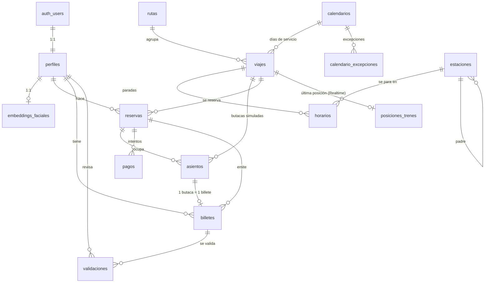

# 🗄️ Modelo de datos (Supabase)

> **Fuente de verdad del esquema.** Se diseña aquí y después se migra en
> `backend/database/supabase/migrations/`. Si el código y esta nota discrepan, manda la nota:
> se cambia primero aquí y luego se implementa (ver `AGENTS.md`).
>
> Alcance de esta versión: **contrato, sin SQL**. No hay migraciones todavía a propósito.

## 1. Principios de diseño

| # | Decisión | Motivo |
|---|---|---|
| 1 | **Claves naturales de GTFS** (`text`) en todo lo que viene del feed; **`uuid`** en lo que genera la app | Los `stop_id`, `route_id`, `trip_id` son estables entre importaciones → `upsert` idempotente sin tablas de mapeo. Los datos de usuario necesitan ids opacos y no adivinables. |
| 2 | **Nombres en español y en plural** (`estaciones`, `viajes`), FKs `<tabla_singular>_id` | Coherente con el resto del proyecto; el móvil y la API leen lo mismo. |
| 3 | **Estados como `text` + `CHECK`**, no `ENUM` de Postgres | Las Supabase migrations corren dentro de una transacción y `ALTER TYPE ... ADD VALUE` no puede ejecutarse ahí. Con `CHECK` añadir un estado es un `ALTER TABLE` normal. |
| 4 | **`timestamptz` en todo**; horas de GTFS en `interval` | Renfe publica horas locales de Madrid (Europe/Madrid) y GTFS permite `25:30` para trenes que terminan pasada la medianoche: `time` no lo admite, `interval` sí. |
| 5 | **Nada se borra en duro salvo catálogo** | Reservas, pagos, billetes y validaciones son historial: se cambian de estado. El catálogo GTFS sí se reemplaza en cada importación. |
| 6 | **La API escribe siempre con `service_role`**; la app solo lee lo suyo | RLS protege el acceso directo de la app (sobre todo Realtime), no sustituye a la API. Ver §6. |
| 7 | **Asientos generados bajo demanda**, no materializados por feed | Materializar butacas de los ~30 000 viajes del feed son millones de filas para un dato simulado. Se generan al vuelo la primera vez que se consulta un viaje. |

## 2. Diagrama de entidades



## 3. Identidad y acceso

### 3.1 `perfiles`

Extiende `auth.users` (que gestiona Supabase Auth y no se toca).

| columna | tipo | null | notas |
|---|---|---|---|
| `id` | `uuid` | no | PK, `references auth.users(id) on delete cascade` |
| `rol` | `text` | no | `viajero` \| `revisor`, default `viajero` |
| `nombre` | `text` | no | para saludar y para el revisor |
| `creado_en` | `timestamptz` | no | default `now()` |
| `actualizado_en` | `timestamptz` | no | default `now()` |

**Diseño:** el perfil lo crea la **API** en `POST /auth/registro`, no un trigger sobre `auth.users`.
Un trigger mágico esconde el flujo y complica los tests; así la API lo hace en la misma
transacción lógica que el alta.
**`rol` no lo puede cambiar el usuario:** solo lo toca la API con `service_role`.

**RLS:** `select`/`update` del propio perfil. El `update` no puede tocar `rol`
(política con `using (id = auth.uid())` y `with check` que compara `rol` con el actual).

**Índices:** PK basta. `rol` tiene pocas filas pero se filtra en el panel del revisor:
índice parcial `(rol) where rol = 'revisor'`.

### 3.2 `embeddings_faciales`

| columna | tipo | null | notas |
|---|---|---|---|
| `usuario_id` | `uuid` | no | PK, FK a `perfiles` `on delete cascade` |
| `embedding` | `vector(512)` | no | InsightFace, normalizado (L2 = 1) |
| `modelo` | `text` | no | p. ej. `insightface/buffalo_l`; permite invalidar al cambiar de modelo |
| `creado_en` | `timestamptz` | no | default `now()` |

**Diseño:** 1:1 con el perfil (verificación 1:1: la app dice quién es y se compara). Si algún día
se quiere 1:N («¿quién es esta cara?») se cambia la PK a `(usuario_id, modelo)` y se añade
índice; hoy no hace falta. **Nunca se guarda la foto**, solo el vector.

**RLS:** **ninguna política** para `anon` ni `authenticated` → nadie lee el embedding desde la app.
Solo `service_role` (la API). La comparación la hace la API o el face-service, nunca el móvil.

**Índices:** PK. Índice HNSW (`vector_cosine_ops`) solo si en el futuro se hace búsqueda 1:N.

## 4. Catálogo GTFS (datos reales de Renfe)

Importado por `backend/gtfs-worker`. Este bloque **sí** se reemplaza en cada importación;
el resto de tablas lo referencian, así que la importación nunca borra en cascada datos de usuario
(ver §8).

### 4.1 `estaciones` ← `stops.txt`

| columna | tipo | null | notas |
|---|---|---|---|
| `id` | `text` | no | PK = `stop_id` |
| `nombre` | `text` | no | `stop_name` |
| `lat` | `double precision` | no | `stop_lat` |
| `lon` | `double precision` | no | `stop_lon` |
| `tipo` | `text` | no | `estacion` \| `acceso`; `location_type` 0/1 |
| `estacion_padre_id` | `text` | sí | FK a `estaciones(id)` (`parent_station`) |
| `anden` | `text` | sí | `platform_code` |
| `accesible` | `boolean` | sí | `wheelchair_boarding` |
| `actualizado_en` | `timestamptz` | no | para depurar importaciones |

**Diseño:** `lat`/`lon` como `double precision`, **sin PostGIS**: no se hacen búsquedas
geográficas (el mapa solo pinta posiciones). Si algún día se quiere «estaciones cerca de mí»,
se añade PostGIS en una migración aparte sin tocar estas columnas.

**RLS:** lectura pública (`anon` + `authenticated`). Escritura solo `service_role`.

**Índices:** PK; `(nombre)` con `pg_trgm` para el autocompletado de `GET /estaciones?q=`;
`(estacion_padre_id)`.

### 4.2 `rutas` ← `routes.txt`

| columna | tipo | null | notas |
|---|---|---|---|
| `id` | `text` | no | PK = `route_id` |
| `nombre` | `text` | no | `route_long_name` («Madrid-Atocha → Barcelona-Sants») |
| `nombre_corto` | `text` | sí | `route_short_name` («AVE», «C-1») |
| `tipo_servicio` | `text` | no | `cercanias` \| `media_distancia` \| `larga_distancia` \| `ave` \| `avlo` \| `alvia` \| `regional` \| `otro` |
| `color` | `text` | sí | hex de `route_color`, para la UI |
| `actualizado_en` | `timestamptz` | no | |

**Diseño:** `route_type` de GTFS vale `2` (rail) para todo Renfe, así que no distingue producto.
`tipo_servicio` lo deduce el worker del `route_short_name`/`route_long_name`
(**pregunta abierta §10.1**). Es lo que usará la UI para el icono y el precio simulado.

**RLS:** lectura pública. Escritura solo `service_role`.
**Índices:** PK.

### 4.3 `calendarios` ← `calendar.txt`

| columna | tipo | null | notas |
|---|---|---|---|
| `id` | `text` | no | PK = `service_id` |
| `lunes` … `domingo` | `boolean` | no | 7 columnas, `monday` … `sunday` |
| `inicio` | `date` | no | `start_date` |
| `fin` | `date` | no | `end_date` |

### 4.4 `calendario_excepciones` ← `calendar_dates.txt`

| columna | tipo | null | notas |
|---|---|---|---|
| `servicio_id` | `text` | no | PK parte 1, FK a `calendarios` `on delete cascade` |
| `fecha` | `date` | no | PK parte 2 |
| `tipo` | `text` | no | `añadido` \| `eliminado` (`exception_type` 1/2) |

**Diseño:** sin estas dos tablas la búsqueda por fecha miente en festivos y puentes, que es
justo cuando más se usa la app. Son pequeñas y se importan tal cual.

**RLS:** lectura pública. Escritura solo `service_role`.
**Índices:** `(fecha, tipo)` en excepciones; PK en calendarios.

### 4.5 `viajes` ← `trips.txt`

| columna | tipo | null | notas |
|---|---|---|---|
| `id` | `text` | no | PK = `trip_id` |
| `ruta_id` | `text` | no | FK a `rutas` |
| `servicio_id` | `text` | no | FK a `calendarios` |
| `destino` | `text` | sí | `trip_headsign` («Barcelona-Sants») |
| `sentido` | `smallint` | sí | `direction_id` 0/1 |
| `accesible` | `boolean` | sí | `wheelchair_accessible` |
| `actualizado_en` | `timestamptz` | no | |

**Diseño clave:** un viaje **no tiene fecha**. Es una plantilla («AVE 03070, laborables») y la
fecha se resuelve con `calendarios` + `calendario_excepciones`. Duplicar el viaje por día
multiplicaría por 365 el feed sin ganar nada. El endpoint `GET /trenes?fecha=` hace el join con
el calendario del día pedido.

**RLS:** lectura pública. Escritura solo `service_role`.
**Índices:** `(ruta_id)`, `(servicio_id)`.

### 4.6 `horarios` ← `stop_times.txt`

| columna | tipo | null | notas |
|---|---|---|---|
| `viaje_id` | `text` | no | PK parte 1, FK a `viajes` `on delete cascade` |
| `secuencia` | `integer` | no | PK parte 2, `stop_sequence` (orden de parada) |
| `estacion_id` | `text` | no | FK a `estaciones` |
| `llega` | `interval` | sí | `arrival_time`; nulo en la primera parada |
| `sale` | `interval` | sí | `departure_time`; nulo en la última |
| `recoge` | `boolean` | no | `pickup_type = 0`, default `true` |
| `deja` | `boolean` | no | `drop_off_type = 0`, default `true` |

**Diseño:** `interval` por las horas `> 24:00` de GTFS (§1.4). La interpretación es
«tiempo desde el inicio del día de servicio», en hora local de Madrid.
`recoge`/`deja` permiten excluir paradas técnicas de la búsqueda.

**Consulta tipo** (la que justifica los índices de abajo):

```sql
-- origen → destino el mismo viaje, en orden
select o.viaje_id, o.sale as sale, d.llega as llega
from horarios o
join horarios d
  on d.viaje_id = o.viaje_id and d.secuencia > o.secuencia
where o.estacion_id = $1 and d.estacion_id = $2
  and o.recoge and d.deja;
```

**RLS:** lectura pública. Escritura solo `service_role`.
**Índices:** PK `(viaje_id, secuencia)`; `(estacion_id, viaje_id)` para el join de arriba.
Es la tabla más grande del catálogo.

## 5. Reserva, pago, billete

### 5.1 `asientos` (simulado)

| columna | tipo | null | notas |
|---|---|---|---|
| `id` | `uuid` | no | PK, default `gen_random_uuid()` |
| `viaje_id` | `text` | no | FK a `viajes` `on delete cascade` |
| `coche` | `smallint` | no | 1…N |
| `numero` | `smallint` | no | 1…N dentro del coche |
| `clase` | `text` | no | `turista` \| `preferente` |
| `ventanilla` | `boolean` | no | para la UI |
| `reserva_id` | `uuid` | sí | FK a `reservas` `on delete set null`; **nulo = libre** |
| `UNIQUE (viaje_id, coche, numero)` | | | |

**Diseño:**
- **Generación perezosa:** la primera vez que se pide `GET /trenes/:id/asientos`, la API crea las
  butacas de ese viaje a partir de una plantilla según `tipo_servicio` y `clase`. Así el feed
  entero no ocupa millones de filas.
- **La ocupación va en `reserva_id`, no en un `estado`**: no hay dos fuentes de verdad. La
  asignación es un `UPDATE` atómico, que resuelve las carreras sin bloqueos explícitos:

  ```sql
  update asientos set reserva_id = $1
  where id = $2 and reserva_id is null
  returning *;   -- 0 filas = alguien se te ha adelantado
  ```
- Al cancelar o caducar una reserva, la API pone `reserva_id = null` en sus asientos en la misma
  transacción. Se pierde el histórico de qué butaca era de una reserva cancelada: aceptable
  porque es simulado.
- **Alternativa descartada:** tabla `reservas_asientos` N:M con `UNIQUE(asiento_id)`. Es más
  «correcta» pero la ocupación exige un join y la carrera se resuelve con índices únicos
  parciales entre dos tablas, que Postgres no permite.

**RLS:** `select` para `authenticated` (la app pinta el mapa de butacas); **escritura solo
`service_role`**. El usuario no puede «reservar» una butaca escribiendo en la tabla.
**Índices:** PK; `(viaje_id) where reserva_id is null` (butacas libres); `(reserva_id)`.
**Precio:** no se guarda por asiento. El importe va en la reserva (§5.2).

### 5.2 `reservas`

| columna | tipo | null | notas |
|---|---|---|---|
| `id` | `uuid` | no | PK |
| `usuario_id` | `uuid` | no | FK a `perfiles` |
| `viaje_id` | `text` | no | FK a `viajes` `on delete restrict`; **una reserva = un viaje** |
| `referencia` | `text` | no | `UNIQUE`, código corto legible (`R-7K3M9Q`) |
| `estado` | `text` | no | `pendiente` \| `pagada` \| `cancelada` \| `caducada`, default `pendiente` |
| `importe_centimos` | `integer` | no | `CHECK (>= 0)`; precio simulado |
| `creada_en` | `timestamptz` | no | default `now()` |
| `expira_en` | `timestamptz` | no | `CHECK (expira_en > creada_en)`; retención de butacas (propuesta: +15 min) |
| `actualizada_en` | `timestamptz` | no | |

**Diseño:** el estado `pendiente` es la **retención**: reserva creada, butacas bloqueadas,
15 minutos para pagar. Si no se paga, la API la pasa a `caducada` y libera butacas
(barrido al consultar + cron opcional). `importe_centimos` en enteros para no arrastrar floats
con dinero; `centimos` explícito en el nombre.
Una reserva puede tener **varias butacas del mismo viaje** (familia): la relación es
`asientos.reserva_id`.

**RLS:** el dueño lee sus reservas; nunca escribe. Escritura solo `service_role`.
**Índices:** `(usuario_id, creada_en desc)` (lista «mis reservas»); `(viaje_id)`;
`UNIQUE (referencia)`; parcial `(expira_en) where estado = 'pendiente'` para el barrido.

### 5.3 `pagos`

| columna | tipo | null | notas |
|---|---|---|---|
| `id` | `uuid` | no | PK |
| `reserva_id` | `uuid` | no | FK a `reservas` |
| `proveedor` | `text` | no | default `stripe` (siempre test) |
| `payment_intent_id` | `text` | no | `UNIQUE`, `pi_…` |
| `importe_centimos` | `integer` | no | copia del importe cobrado, no se lee de la reserva |
| `moneda` | `char(3)` | no | default `eur` |
| `estado` | `text` | no | `creado` \| `requiere_accion` \| `exitoso` \| `fallido` \| `reembolsado` |
| `ultimo_evento_stripe` | `text` | sí | `UNIQUE` parcial; `event.id` del webhook → **idempotencia** |
| `creado_en` / `actualizado_en` | `timestamptz` | no | |

**Diseño:** N intentos por reserva (el usuario reintenta con otra tarjeta), pero **un solo pago
exitoso**: índice único parcial `(reserva_id) where estado = 'exitoso'`. El webhook de Stripe
puede repetir el mismo evento; `ultimo_evento_stripe` con `UNIQUE` lo hace idempotente
(`INSERT ... ON CONFLICT DO NOTHING`). El importe se copia para que un cambio de precio
posterior no reescriba el histórico.

**RLS:** el dueño lee los pagos de sus reservas (vía `reservas.usuario_id`). Escritura solo
`service_role` (y el webhook, que también usa `service_role`).
**Índices:** `(reserva_id)`; `UNIQUE (payment_intent_id)`; unique parcial
`(reserva_id) where estado = 'exitoso'`; unique parcial `(ultimo_evento_stripe)`.

### 5.4 `billetes`

| columna | tipo | null | notas |
|---|---|---|---|
| `id` | `uuid` | no | PK; **es el `jti` que va firmado dentro del QR** |
| `reserva_id` | `uuid` | no | FK a `reservas` |
| `asiento_id` | `uuid` | no | `UNIQUE`, FK a `asientos` |
| `usuario_id` | `uuid` | no | FK a `perfiles` (desnormalizado para RLS y consultas) |
| `viaje_id` | `text` | no | FK a `viajes` (desnormalizado para el revisor) |
| `estado` | `text` | no | `valido` \| `usado` \| `anulado` \| `caducado` |
| `emitido_en` | `timestamptz` | no | |
| `expira_en` | `timestamptz` | no | fin del día de servicio + margen |
| `usado_en` | `timestamptz` | sí | |

**Diseño:** **1 billete = 1 butaca = 1 viajero**. Una reserva de 3 plazas genera 3 billetes con
3 QR distintos; es lo que espera un revisor y lo que permite anular uno sin tocar los demás.
El contenido del QR (`{billete_id, viaje_id, usuario_id, exp}` firmado con Ed25519) **no se
guarda**: solo la clave privada firma y la firma se verifica con la pública. Lo que manda es
`estado` en BD: firma válida + estado `valido` = billete bueno.
`usuario_id` y `viaje_id` están duplicados a propósito (evitan dos joins en la validación y
simplifican la política RLS); se rellenan siempre desde la reserva.

**RLS:** el dueño lee sus billetes; nunca escribe (no puede marcar `usado`). Escritura solo
`service_role`. El revisor **no** lee la tabla directamente: llama a `POST /billetes/validar`.
**Índices:** `UNIQUE (asiento_id)`; `(usuario_id, emitido_en desc)`; `(viaje_id, estado)`.

### 5.5 `validaciones`

| columna | tipo | null | notas |
|---|---|---|---|
| `id` | `uuid` | no | PK |
| `billete_id` | `uuid` | no | FK a `billetes` |
| `revisor_id` | `uuid` | no | FK a `perfiles` (rol `revisor`) |
| `resultado` | `text` | no | `valido` \| `ya_usado` \| `caducado` \| `firma_invalida` \| `no_encontrado` |
| `motivo` | `text` | sí | texto libre del revisor |
| `validado_en` | `timestamptz` | no | default `now()` |

**Diseño:** tabla **append-only**, incluida la auditoría de los intentos fallidos: si un revisor
dice «este QR no vale», queda registrado con el motivo. Nunca se actualiza ni se borra.
`billetes.estado` es el estado actual; `validaciones` es el histórico.

**RLS:** el revisor lee sus propias validaciones; el viajero no lee nada de aquí.
Escritura solo `service_role`.
**Índices:** `(billete_id, validado_en desc)`; `(revisor_id, validado_en desc)`.

## 6. Tiempo real

### 6.1 `posiciones_trenes` ← GTFS-RT `VehiclePosition`

| columna | tipo | null | notas |
|---|---|---|---|
| `viaje_id` | `text` | no | **PK**, FK a `viajes` |
| `lat` | `double precision` | no | |
| `lon` | `double precision` | no | |
| `retraso_seg` | `integer` | sí | de `TripUpdate.delay` si viene |
| `rumbo` | `smallint` | sí | 0–359 |
| `velocidad_kmh` | `smallint` | sí | |
| `proxima_estacion_id` | `text` | sí | FK a `estaciones` |
| `actualizado_en` | `timestamptz` | no | `VehiclePosition.timestamp` |

**Diseño:** **una fila por viaje** (upsert), no un histórico. El mapa necesita el estado actual y
Realtime manda un payload pequeño; si se insertara cada posición, el canal escupiría miles de
eventos por minuto. Histórico (`posiciones_historial`, retención 24 h) solo si el mapa necesita
estelas — **fuera de alcance**.
El payload del canal respeta [[eventos-realtime]]: `{ viaje_id, lat, lon, retraso_seg, actualizado }`;
`rumbo`, `velocidad_kmh` y `proxima_estacion_id` son **opcionales** y no rompen el contrato.

**RLS:** lectura `anon` + `authenticated` (el mapa puede verse antes de logarse, como en la app
de Renfe). Escritura solo `service_role` (el worker).
**Realtime:** publicación activada solo para `UPDATE` de esta tabla.
**Índices:** PK. `(actualizado_en)` para limpiar posiciones viejas (un tren que desaparece del
feed debe dejar de pintarse).

## 7. Resumen de permisos (RLS)

`service_role` **salta RLS** por diseño: es la API y el worker. Las políticas existen para el
acceso directo desde la app (lectura y Realtime) y para que un `anon` con la `anon key` no vea
nada que no toque.

| Tabla | `anon` | `authenticated` | `service_role` |
|---|---|---|---|
| `perfiles` | — | lee/edita el suyo | todo |
| `embeddings_faciales` | — | — | todo |
| `estaciones`, `rutas`, `calendarios`, `calendario_excepciones`, `viajes`, `horarios` | lectura | lectura | todo |
| `asientos` | — | lectura | todo |
| `reservas`, `pagos`, `billetes` | — | lee los suyos | todo |
| `validaciones` | — | el revisor, las suyas | todo |
| `posiciones_trenes` | lectura | lectura | todo |

## 8. Volumen, importación y retención

| Tabla | Filas estimadas | Notas |
|---|---|---|
| `estaciones` | ~1 500 | según feed |
| `rutas` | ~100 | |
| `calendarios` + excepciones | ~1 000 | |
| `viajes` | ~30 000 | plantillas, no por día |
| `horarios` | ~500 000 | **la tabla grande**; se reemplaza en cada importación |
| `asientos` | bajo demanda | solo viajes consultados |
| `reservas`, `pagos`, `billetes` | crecimiento de la app | historial, no se borra |
| `posiciones_trenes` | ≈ nº de trenes en circulación | upsert; filas viejas se purgan por `actualizado_en` |

- La importación GTFS es **idempotente** (`upsert` por clave natural) y corre en una transacción:
  o entra el feed entero o no entra nada.
- Al importar un feed nuevo, los viajes que ya no existen se marcan/borran **antes** de tocar
  `reservas`: la FK de `reservas.viaje_id` es `on delete restrict` para que un feed nuevo no se
  lleve por delante reservas pagadas. Decisión fina de implementación en la rama del worker.
- **Borrado de cuenta:** `on delete cascade` desde `auth.users` → `perfiles` → `embeddings`,
  y las reservas/billetes quedan anonimizadas por la API (no se borran: son historial contable).

## 9. Lo que este modelo **no** incluye (a propósito)

| No está | Por qué |
|---|---|
| Precios reales, tarifas y descuentos | Simulados: el importe se calcula en la API y se guarda en la reserva |
| Asientos y ocupación reales | Renfe no los publica |
| `shapes`, `transfers`, `frequencies`, `agency` de GTFS | No aportan a las pantallas del sprint; se pueden añadir sin romper nada |
| Favoritos, notificaciones, historial del chatbot | No están en el Sprint 0/1; no se inventan |
| Fotos de usuario | Prohibido: solo embeddings |
| PostGIS | No hay consultas geográficas; Realtime solo pinta puntos |

## 10. Preguntas abiertas (para cerrar el contrato)

1. **`tipo_servicio` (Rubén / Marina):** ¿lo deducimos del nombre de la ruta en el worker o lo
   mantenemos a mano en una tabla pequeña? Propuesta: heurística en el worker y revisión manual.
2. **Retención de butacas (Alex / Rubén):** ¿15 minutos es suficiente para el flujo de pago de la
   app? Afecta a `reservas.expira_en`.
3. **Un billete por butaca o por reserva (Alex):** propuesta 1:1 con la butaca. Si el grupo quiere
   un solo QR para toda la reserva, cambia §5.4.
4. **Caducidad del QR (Rubén / Kevin):** ¿hasta el fin del día de servicio o unas horas después?
5. **Histórico de posiciones (Alex):** ¿hace falta estela en el mapa o basta el punto actual?
6. **Nombre de las horas (Rubén):** he puesto `llega`/`sale` y `recoge`/`deja` en español.
   Si prefieres `llegada`/`salida`, se cambia ahora y no después.

## 11. Próximos pasos

1. Cerrar las preguntas de §10.
2. Primera migración: extensión `vector` + tablas de identidad y catálogo (§3 y §4).
3. Después: reserva/pago/billete (§5) y Realtime (§6).
4. Solo entonces, tipos compartidos y endpoints de [[endpoints]] contra nombres definitivos.
